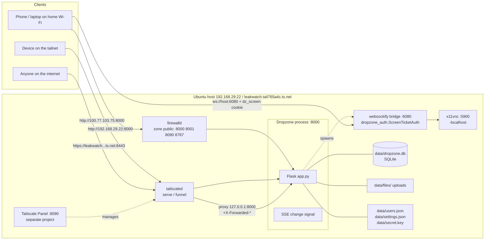
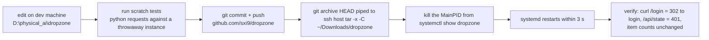
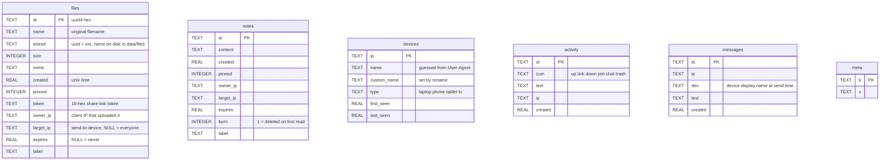
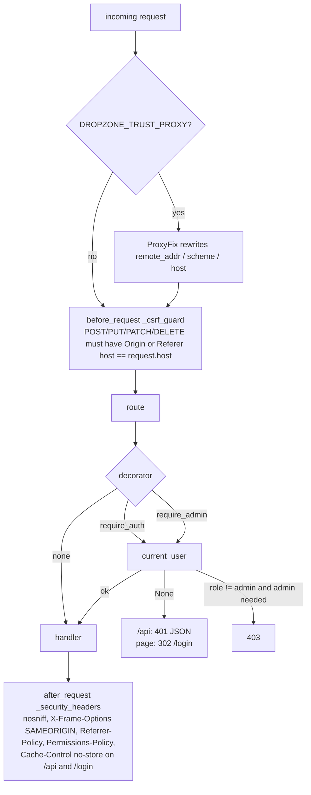
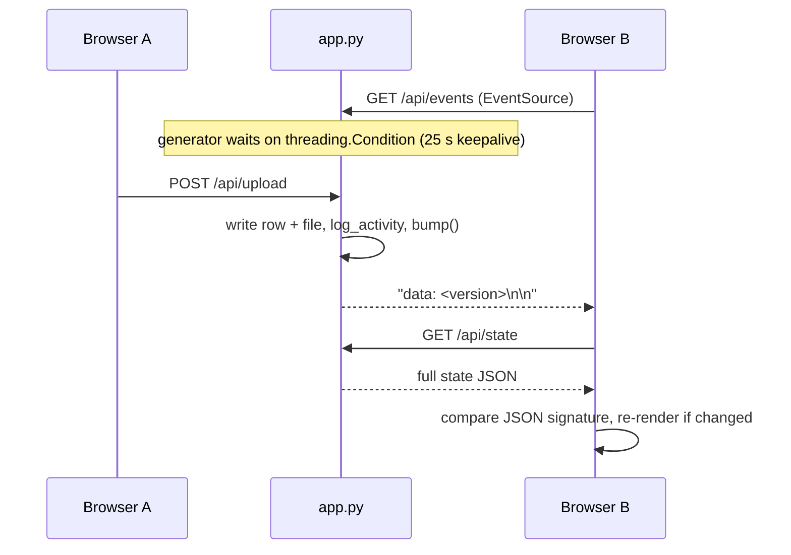
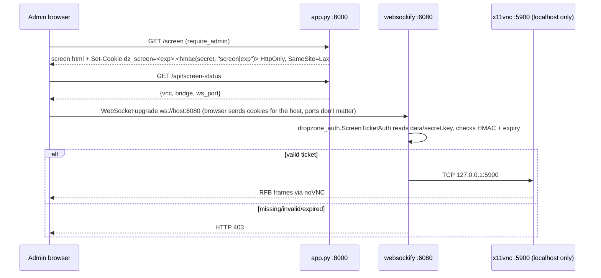
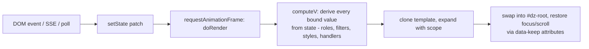
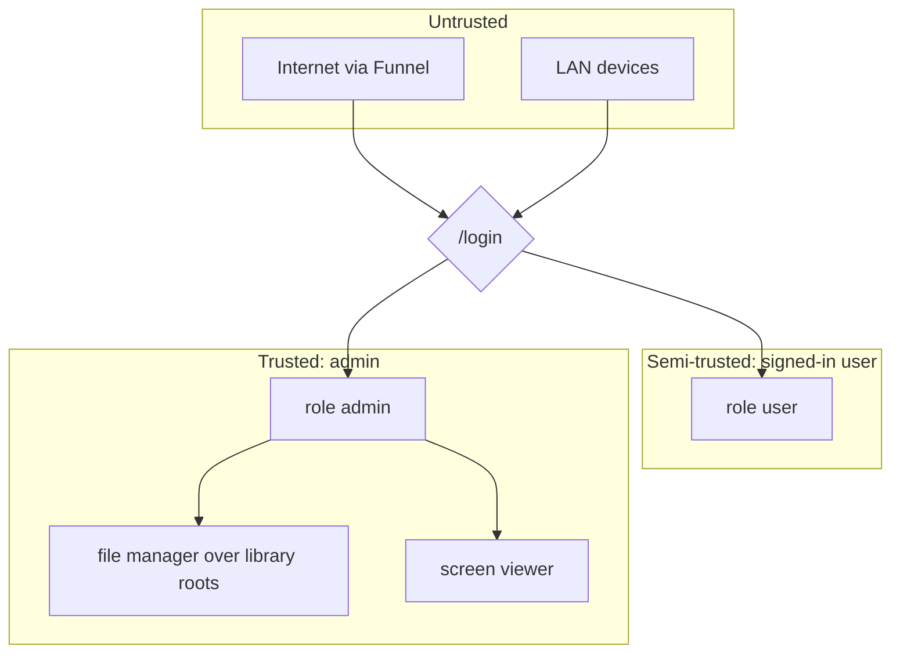
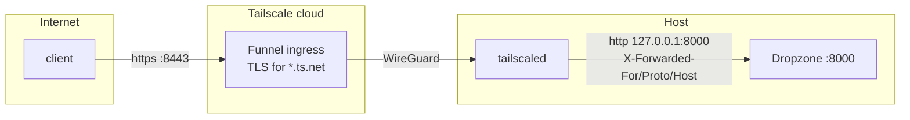

# Dropzone — end-to-end architecture

> Audience: a developer (human or LLM) who has never seen this project and must run it, change it, or debug it.
> Everything here is derived from the code as of commit `b89a484` (v6). When code and this document disagree, the code wins — then fix the document.

---

## 1. What Dropzone is

Dropzone is a **self-hosted share point for a home network**: a single Python/Flask process that lets every device on the Wi-Fi (and, via Tailscale, anywhere) drop files, text notes, secret notes, voice memos and chat messages into one shared feed. It also offers an admin panel (storage, accounts, a server-folder library and file manager) and an optional remote-desktop viewer of the host machine.

Design principles that explain most decisions in the code:

| Principle | Consequence |
|---|---|
| **No build step, no framework** | One `app.py`, HTML files with inline CSS/JS, a 90-line home-made template interpreter instead of React/Vue. |
| **One process, one folder** | SQLite + files on disk under `data/`. No Redis, no Postgres, no Docker required. |
| **Private by default, hardened for the internet** | Accounts with hashed passwords, role gating, CSRF/origin checks, hardening headers, authenticated VNC bridge, so it can sit behind Tailscale Funnel. |
| **Backwards compatible data** | DB migrations add columns in place; `data/` is never rewritten by a deploy. |

---

## 2. System context



Three ways in, one process:

1. **LAN** — plain HTTP on port 8000, allowed through firewalld.
2. **Tailnet** — same port, reached over the WireGuard tunnel; traffic is already encrypted.
3. **Internet** — `tailscale funnel --https=8443 http://127.0.0.1:8000`. Tailscale terminates TLS and proxies to localhost with `X-Forwarded-For` / `X-Forwarded-Proto`; Dropzone trusts those only because the service runs with `DROPZONE_TRUST_PROXY=1` and `DROPZONE_HTTPS=1`.

---

## 3. Repository layout

```
dropzone/
├── app.py                 # the entire backend (~1270 lines): config, accounts, DB, routes, admin, file manager, VNC bridge, CLI
├── dropzone_auth.py       # websockify auth plugin: only admins holding a signed ticket may reach the VNC server
├── templates/
│   ├── index.html         # main UI: styles + markup template + mini interpreter + app logic (~1030 lines)
│   ├── admin.html         # admin panel (plain JS, no interpreter)
│   ├── login.html         # Jinja-rendered sign-in page (username + password)
│   └── screen.html        # full-page noVNC client for the remote screen
├── static/novnc/          # vendored noVNC client (core/, vendor/)
├── dropzone.service       # systemd unit (system level, runs as the login user)
├── x11vnc.service         # optional systemd unit for the screen server
├── requirements.txt       # Flask, qrcode, websockify
├── .env.example           # every environment variable, documented
├── docs/                  # screenshots + this document
├── README.md  CHANGELOG.md  CONTRIBUTING.md  LICENSE
└── data/  (git-ignored, created at first run)
    ├── dropzone.db        # SQLite database
    ├── files/             # uploaded files, stored as <uuid><ext>
    ├── users.json         # accounts: salted PBKDF2 hashes (mode 600)
    ├── settings.json      # admin settings: library roots (mode 600)
    └── secret.key         # Flask session signing key + HMAC key for screen tickets (mode 600)
```

`templates/index.html` is served with `send_file`, **not** rendered by Jinja — its `{{ }}` syntax belongs to the in-page interpreter (section 7). Only `login.html` goes through Jinja.

---

## 4. Runtime and deployment

### 4.1 Production host

| Item | Value |
|---|---|
| Machine | Ubuntu laptop, hostname `saibala-Aspire-E5-573`, LAN `192.168.29.22`, Tailscale `100.77.103.75` / `leakwatch.tail765a4c.ts.net` |
| Code | `~/Downloads/dropzone` (plain copy, **not** a git checkout) |
| Interpreter | `~/Downloads/dropzone/venv/bin/python` (Python 3.10, Flask 3.1, websockify) |
| Service | `dropzone.service` (system unit, `User=saibala`, `Restart=always`) |
| Env overrides | drop-in `/etc/systemd/system/dropzone.service.d/tailscale.conf` → `DROPZONE_HTTPS=1`, `DROPZONE_TRUST_PROXY=1` |
| Data | `~/Downloads/dropzone/data` (≈3.4 GB) |
| Firewall | **firewalld** (ufw is installed but inactive). New ports: `sudo firewall-cmd --permanent --zone=public --add-port=PORT/tcp && sudo firewall-cmd --reload` |
| Public exposure | `tailscale funnel --bg --https=8443 http://127.0.0.1:8000` |
| Rollback copy | `~/Downloads/dropzone.bak-v4-20261013-1540` (pre-v6 code) |

### 4.2 Deploy pipeline (what actually happens)



* `git archive` never contains `data/` (git-ignored), so uploads and the DB survive every deploy.
* Killing the main PID is the no-sudo restart; the user has no passwordless sudo.
* **Do not** `pkill -f app.py` from inside an SSH command — the pattern matches the SSH shell's own command line and kills the session.

### 4.3 Process start-up order (`app.py` bottom)

1. `init_db()` — create tables, apply column migrations.
2. If not a CLI command: `bootstrap_accounts_from_env()` (hash `DROPZONE_ADMIN_PASSWORD` / `DROPZONE_USER_PASSWORD` if set) and `_start_websockify()` (child process, restarted forever by a daemon thread).
3. `app.run(host="0.0.0.0", port=PORT, threaded=True)` — Flask's dev server, one thread per request. Adequate for a household; swap for gunicorn if you ever need more (`init_db` and the websockify spawn run at import time, so a WSGI server works unchanged).

### 4.4 CLI (same file)

```
python app.py set-password <name> [--role admin|user]   # prompts twice on a TTY, reads one line from stdin otherwise
python app.py users
python app.py remove-user <name>
```
`users.json` is re-read on every request, so password changes take effect without a restart; changing a password bumps the account's `ver`, which invalidates its existing sessions.

---

## 5. Backend

### 5.1 Configuration (environment variables)

| Variable | Default | Effect |
|---|---|---|
| `DROPZONE_PORT` | 8000 | listen port |
| `DROPZONE_DATA` | `./data` | data directory |
| `DROPZONE_ADMIN_PASSWORD` / `DROPZONE_USER_PASSWORD` | unset | create/overwrite that account at start-up |
| `DROPZONE_PIN` | unset | legacy: acts as the `user` password while no `user` account exists |
| `DROPZONE_SESSION_HOURS` | 24 | permanent session lifetime |
| `DROPZONE_HTTPS` | 0 | `Secure` flag on cookies |
| `DROPZONE_TRUST_PROXY` | 0 | wrap app in `ProxyFix(x_for=1, x_proto=1, x_host=1)` |
| `DROPZONE_PUBLIC_SHARE` | 0 | `/s/<token>` works without login |
| `DROPZONE_MAX_MB` | 2048 | upload cap (also Flask `MAX_CONTENT_LENGTH`) |
| `DROPZONE_EXPIRE_DAYS` | 0 | auto-delete items older than N days |
| `DROPZONE_VNC_PORT` / `DROPZONE_WS_PORT` | 5900 / 6080 | screen viewer ports |

### 5.2 Data model



Identity in the feed is **by client IP**, not by account: `owner_ip`, `target_ip`, `devices.ip`. Accounts only decide *role* (what you may do); the device list and "my items" come from the address you connect from. Behind a proxy without `DROPZONE_TRUST_PROXY=1` everyone would share `127.0.0.1` — that is why the flag exists.

Outside SQLite:

* `data/files/<stored>` — file bytes. Deleting a row also `os.remove`s the file.
* `data/users.json` — `{name: {role, salt, iter, hash, ver, updated}}`; PBKDF2-HMAC-SHA256, 600 000 rounds.
* `data/settings.json` — `{"library_roots": [{name, path}]}` for the admin file manager; defaults to the service user's home.
* `data/secret.key` — 32 random bytes; Flask `secret_key` and the HMAC key for screen tickets.

### 5.3 Request pipeline



`current_user()` rules:

* No accounts and no PIN → **open mode**: everyone is an implicit admin (backwards compatibility, prints a warning at start).
* Session must carry `u`, `r`, `v`; the account must still exist and `v` must equal its current `ver`.
* Legacy PIN sessions are `{u: "user", v: 0}` and stay valid only while no real `user` account exists.

### 5.4 Change signal (live updates)



Every mutating handler ends with `bump()`, which increments `_version` and `notify_all()`s the condition. Clients don't receive the change itself, just a nudge to refetch `/api/state`; a 15 s poll runs as a fallback.

### 5.5 Visibility and ownership

* `visible(row, me)` — an item is visible if it has no `target_ip`, or it targets me, or I own it. Applied in `/api/state`, `/file/<id>`, `/api/preview-text`, `/api/zip`.
* `_may_delete(row, me)` — admins delete anything; users only rows whose `owner_ip == me`. Used by single and bulk delete.
* Device rename: own IP or admin.

### 5.6 Admin file manager — path confinement

```python
base   = realpath(root.path)
target = realpath(join(base, rel))           # resolves symlinks and ".."
ok     = target == base or target.startswith(base + os.sep)
```
Every `/api/fm/*` call goes through `_fm_resolve`; names for upload/mkdir/rename pass `_safe_name` (basename only, rejects `.`/`..`). The root itself cannot be deleted or renamed; moves refuse to move a folder into itself.

### 5.7 Remote screen viewer



Why a cookie: cookies are scoped to the host name, not the port, so a cookie set by `:8000` is automatically presented to `:6080`. The bridge never learns any password; it only verifies an HMAC with the shared `secret.key`.

---

## 6. API reference

Auth column: **any** = any signed-in account (or open mode), **admin** = admin role, **none** = public.

### Pages
| Method | Path | Auth | Notes |
|---|---|---|---|
| GET | `/` | any | serves `templates/index.html` |
| GET/POST | `/login` | none | form fields `username`, `password`; 5 failures per IP → 5 min lock |
| POST | `/logout` | none | clears session + `dz_screen` cookie |
| GET | `/admin` | admin | serves `admin.html` |
| GET | `/screen` | admin | serves `screen.html`, sets `dz_screen` ticket |
| GET | `/qr.svg` | any | QR of `request.host_url` |

### Feed
| Method | Path | Auth | Body / query | Returns |
|---|---|---|---|---|
| GET | `/api/state` | any | — | `{items, devices, activity, chat, me, remote, stats(admin only), user, role, admin, auth}` |
| GET | `/api/events` | any | — | SSE stream |
| POST | `/api/upload` | any | multipart `files[]`, `target` | `{saved}` |
| POST | `/api/note` | any | `{content, burn, expire_hours, target}` | `{ok}` |
| POST | `/api/chat` | any | `{text}` | `{ok}` |
| POST | `/api/fetch-url` | admin | `{url}` | `{ok, name}` — server-side download (SSRF-capable, hence admin) |
| POST | `/api/pin/<kind>/<id>` | any | kind = `file`\|`note` | toggles pinned |
| POST | `/api/reveal/<id>` | any | — | returns and deletes a burn note |
| DELETE | `/api/item/<kind>/<id>` | any | — | 403 unless admin or owner |
| POST | `/api/bulk-delete` | any | `{ids:[{kind,id}]}` | `{deleted, skipped}` |
| POST | `/api/label` | any | `{ids, label}` | `{labeled}` |
| GET | `/api/zip?ids=a,b` | any | — | zip of visible files |
| GET | `/api/preview-text/<id>` | any | — | first 200 kB of a text file |
| POST | `/api/device/name` | any | `{ip, name}` | own device, or admin |
| POST | `/api/cleanup` | admin | `{mode: older30\|unpinned}` | `{deleted}` |
| POST | `/api/password` | any | `{current, new}` | changes own password, keeps this session |

### Files
| Method | Path | Auth | Notes |
|---|---|---|---|
| GET | `/file/<id>` | any | inline; HTML/XML/JS forced to attachment; SVG gets `CSP: sandbox` |
| GET | `/file/<id>/download` | any | attachment |
| GET | `/s/<token>` | any (none if `DROPZONE_PUBLIC_SHARE=1`) | share link |

### Admin panel
| Method | Path | Body | Notes |
|---|---|---|---|
| GET | `/api/admin/overview` | — | `{me, users, storage{disk_total,disk_free,disk_used,dropzone_used,file_count,note_count,largest}, roots}` |
| POST | `/api/admin/users` | `{name, role?, password?}` | create/reset/re-role; can't demote self |
| DELETE | `/api/admin/users/<name>` | — | can't delete self or last admin |
| POST | `/api/admin/roots` | `{name, path}` | folder must exist |
| DELETE | `/api/admin/roots/<name>` | — | |
| GET | `/api/fm/list?root&path` | — | `{root, path, entries[{name,dir,link,size,mtime,mime}]}` |
| GET | `/api/fm/download?root&path` | — | file, or folder as zip |
| POST | `/api/fm/upload` | multipart `root, path, files[]` | |
| POST | `/api/fm/mkdir` | `{root, path, name}` | |
| POST | `/api/fm/rename` | `{root, path, name}` | |
| POST | `/api/fm/move` | `{root, paths[], dest}` | |
| POST | `/api/fm/delete` | `{root, paths[]}` | recursive |
| POST | `/api/fm/share` | `{root, path}` | copies file into the feed |
| GET | `/api/screen-status` | — | `{vnc, bridge, ws_port, error}` |

Error convention: JSON `{error: "..."}` with 400/401/403/404/413/500; pages redirect to `/login` on 401.

---

## 7. Frontend

### 7.1 `index.html` — the main app

The page is three things in one file:

1. **CSS** in `<head>` (theme tokens on `:root` and `html[data-theme=dark]`).
2. **A `<template id="dz-tpl">`** holding the whole UI markup with bindings.
3. **A script** containing a ~90-line template interpreter, the application state, and all handlers, wrapped in an IIFE (`"use strict"`; nothing is global).

Binding syntax understood by the interpreter (`expand` / `handle` / `bindAttrs`):

| Syntax | Meaning |
|---|---|
| `{{ path.to.value }}` in text | text content; if the value is `{__html: "..."}` it is inserted as HTML (used for icons) |
| `attr="{{ expr }}"` | attribute value; `value` on inputs sets `.value`; `disabled/hidden/checked/selected` are boolean |
| `onclick="{{ fn }}"` (any `on*`) | `addEventListener`; `null`/non-function = no listener |
| `ref="{{ fn }}"` | calls `fn(element)` after creation (file input, chat scroll, target select) |
| `style-hover="..."` / `style-focus` | appends CSS on hover/focus, restores on leave |
| `<sc-if value="{{ cond }}">…</sc-if>` | conditional block |
| `<sc-for list="{{ arr }}" as="it">…</sc-for>` | repeat block; `it` is added to scope |

Only dotted lookups are supported (`it.name`, `d.you`) — **no expressions**. All computed values are prepared in `computeV()`.



Role awareness lives in `computeV`: `isAdmin`, `authOn`, `userTag`, per-item `canDelete`, device `renameHandler` (null for non-owners), `showFetchUrl` (admin only), the storage meter percentages. The template hides admin-only blocks with `<sc-if value="{{ isAdmin }}">`.

Data sync: `loadState()` fetches `/api/state`, computes `JSON.stringify([...])` as a signature and skips re-render when unchanged; `startSync()` opens the EventSource and a 15 s fallback poll.

Clipboard: `copyText()` uses `navigator.clipboard` only in secure contexts and otherwise a hidden-textarea `execCommand("copy")` fallback (plain HTTP on a LAN IP is not a secure context).

### 7.2 `admin.html`

Plain JavaScript, no interpreter: four tabs (Overview, Accounts, Library, Files). Talks only to `/api/admin/*`, `/api/fm/*`, `/api/cleanup`, `/api/password`, `/api/item`. The file-manager state is `{root, path, entries, sel}`; every destructive action asks `confirm()`.

### 7.3 `screen.html`

Loads `static/novnc/core/rfb.js`, polls `/api/screen-status`, connects `RFB` to `ws(s)://<host>:<ws_port>`.

---

## 8. Security model

### 8.1 Roles

| Capability | user | admin |
|---|---|---|
| Browse, download, copy, pin, label, chat, upload, notes | ✓ | ✓ |
| Delete | own items | anything |
| Rename devices | own | any |
| Storage stats / panel / cleanup | | ✓ |
| Server-side URL fetch | | ✓ |
| Accounts, library roots, file manager | | ✓ |
| Remote screen | | ✓ |

### 8.2 Threats and where they are handled

| Threat | Mitigation | Where |
|---|---|---|
| Password guessing | PBKDF2 600k rounds, constant-time compare, equal-cost miss path, per-IP lockout 5/5 min | `check_password`, `login_failed` |
| Session theft / fixation | `session.clear()` on login, HttpOnly + SameSite=Lax (+Secure), `ver` bump on password change | `login`, `set_password`, `current_user` |
| CSRF | SameSite cookies **and** Origin/Referer host check on every write | `_csrf_guard` |
| Stored XSS via uploads | HTML/XML/JS served as attachment, SVG under `CSP: sandbox`, `nosniff` | `_serve`, `_security_headers` |
| Clickjacking | `X-Frame-Options: SAMEORIGIN` | `_security_headers` |
| IP spoofing of ownership/targets | `X-Forwarded-For` ignored unless `DROPZONE_TRUST_PROXY=1` | `client_ip`, ProxyFix |
| Unauthenticated VNC | websockify auth plugin requires HMAC ticket issued only to admins | `dropzone_auth.py`, `/screen` |
| SSRF through URL fetch | admin only | `api_fetch_url` |
| Path traversal in file manager | realpath confinement + basename-only names | `_fm_resolve`, `_safe_name` |
| Secrets on disk readable by others | `secret.key`, `users.json`, `settings.json` written mode 600 | `_write_private` |
| Lock-out mistakes | can't demote/delete self, can't remove last admin | `api_admin_user_*` |

### 8.3 Trust boundaries



Known limitations worth telling a future developer:

* Ownership is by IP. Two accounts on one device share "mine"; one account on two devices gets two identities.
* The admin file manager exposes whole directories (default: the service user's home) to any admin. Admin = full control of the machine's user account.
* Flask's dev server is used in production. Fine for a household, not for hundreds of users.
* No rate limit on uploads/chat beyond `MAX_CONTENT_LENGTH`.

---

## 9. Networking and exposure



* Funnel is restricted by Tailscale to ports 443, 8443, 10000. Port 443 on this node already serves another app (`127.0.0.1:8787`), so Dropzone uses 8443.
* Screen viewer over the internet is **not** published (and should not be). Over the tailnet use `http://100.77.103.75:8000`.
* firewalld only matters for the LAN path; Funnel/tailnet traffic enters via `tailscale0`.
* Companion project **Tailscale Panel** (`https://github.com/sxi9/tailscale-panel`, port 8090, user-level systemd unit, own accounts) is the UI for turning Funnel/Serve on and off per service.

---

## 10. Operations runbook

| Task | How |
|---|---|
| Status / logs | `systemctl status dropzone`, `journalctl -u dropzone -n 100 -f` |
| Restart without sudo | `kill $(systemctl show dropzone -p MainPID --value)` |
| Create / reset a password | `cd ~/Downloads/dropzone && venv/bin/python app.py set-password admin` |
| Who exists | `venv/bin/python app.py users` |
| Deploy a commit | `git archive --format=tar HEAD \| ssh saibala@192.168.29.22 'cd ~/Downloads/dropzone && tar -xf - && kill $(systemctl show dropzone -p MainPID --value)'` |
| Verify after deploy | `curl -I http://192.168.29.22:8000/` → 302 to `/login`; `curl http://192.168.29.22:8000/api/state` → 401 |
| Back up data | `rsync -a ~/Downloads/dropzone/data/ /some/backup/` (DB is a single file; stop the service for a consistent copy or use `sqlite3 data/dropzone.db ".backup out.db"`) |
| Roll back code | `cp -a ~/Downloads/dropzone.bak-v4-*/{app.py,templates,static} ~/Downloads/dropzone/` then restart (data stays compatible) |
| Open a new LAN port | `sudo firewall-cmd --permanent --zone=public --add-port=PORT/tcp && sudo firewall-cmd --reload` |
| Make public / private | Tailscale Panel, or `tailscale funnel --https=8443 off` / `tailscale serve --bg --https=8443 http://127.0.0.1:8000` |
| Lost admin password | SSH in, `set-password admin` (no recovery flow in the UI by design) |

Troubleshooting map:

| Symptom | Likely cause |
|---|---|
| Everyone appears as the same device / lockout hits everyone | behind a proxy without `DROPZONE_TRUST_PROXY=1` |
| "Copied" but clipboard empty on an old build | pre-v6 clipboard code on plain HTTP; fixed by fallback |
| Screen tab says bridge offline | websockify not installed in venv, or plugin import failed (`cwd=HERE`, `PYTHONPATH`) |
| Port reachable on host but not from LAN | firewalld zone `public` — ufw status is misleading, it is inactive |
| 403 on every POST | Origin/Referer host ≠ Host header (wrong proxy `X-Forwarded-Host`, or opening the app by a different name than the browser uses) |

---

## 11. Developing

### 11.1 Run locally

```bash
python -m venv venv && venv/bin/pip install -r requirements.txt   # Windows: venv\Scripts\python
python app.py set-password admin
python app.py                     # http://localhost:8000
```
No build step; edit a template and reload.

### 11.2 Testing approach used so far

There is no committed test suite yet. The pattern used during development (worth committing under `tests/`):

1. Start `app.py` as a subprocess with `DROPZONE_DATA` pointing at a temp dir and a random port.
2. Create accounts with the CLI (`input="pw\n"`).
3. Drive the API with `requests.Session` per role and assert status codes / JSON / on-disk effects.
4. Kill the subprocess; print its output if it contains `Traceback`.

Coverage achieved that way for v6: 46 checks for auth/roles/CSRF/share/hardening, 10 for password change, 35 for admin panel + file manager (incl. traversal attempts).

### 11.3 Conventions

* Line endings: the repo is checked out with CRLF on Windows (`core.autocrlf`); write files with `newline="\n"` from scripts and let git normalise.
* Keep `app.py` single-file; sections are separated by `# ----- name` banners in this order: config → accounts → throttling → database → change signal → helpers → auth → pages → state → SSE → create → item ops → labels/cleanup → admin → file manager → screen → serving → CLI → bootstrap.
* Every mutating route: `touch_device(conn)` → change → `log_activity` → `bump()` → JSON.
* New admin-only feature: use `@require_admin`, add it to the role table in README and here, hide its UI behind `isAdmin` in `computeV`.
* New config: env var with a default at the top of `app.py`, a row in `.env.example`, README table, and this document.
* Anything that writes secrets to disk goes through `_write_private`.

### 11.4 Adding a feature — checklist

1. Schema change? Add the column to `CREATE TABLE` **and** to the migration list in `init_db`.
2. Route + decorator + visibility/ownership checks.
3. `bump()` if the feed changes.
4. Frontend: state field → `computeV` value → template binding (remember: no expressions in `{{ }}`).
5. Test with a throwaway instance (section 11.2).
6. CHANGELOG entry, README, this document.
7. Commit, push, deploy (section 4.2), verify counts in `/api/state` unchanged.

### 11.5 Ideas not yet built

* Account-based (not IP-based) ownership.
* Per-user visibility of items.
* Folder browsing in the shared feed (today: labels only).
* Committed test suite + CI.
* gunicorn/uvicorn behind the same Tailscale setup.

---

## 12. Version history (summary)

| Version | Highlights |
|---|---|
| v3 | files + notes + devices |
| v4 | share links, multi-select, burn notes, send-to-device, voice memos, URL fetch |
| v5 | remote screen viewer, labels, storage panel, slim remote mode |
| v6 (2026-10-13) | admin/user accounts, hardening, authenticated screen bridge, clipboard fix, change-password, admin panel with storage meter, account management, directory library and file manager; deployed behind Tailscale Funnel |

Full details: `CHANGELOG.md`.
